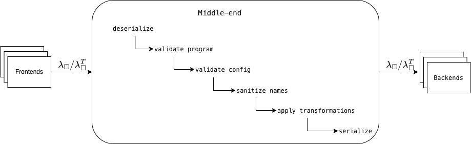
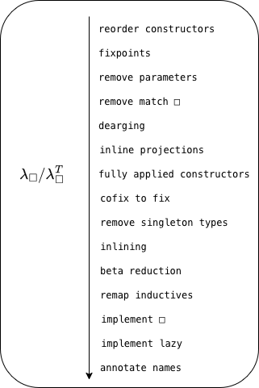

# Peregrine Middle-end

The middle-end connects frontends and backends and serves three purposes:

1) Defines a common IR and configuration format and is responsible for converting to the formats expected by the backends
   
   For more details on IR and configuration format see [format.md](format.md).

2) Validates and ensure $\lambda_\square$ and frontend/backend configuration is compatible
3) Lower $\lambda_\square$ to the necessary subset compatible with the backends, and apply common program transformations and optimizations

This document details points 2 and 3 and shows the general middle-end pipeline.
For more details on frontends and backends, see [frontends.md](frontends.md), [backends.md](backends.md).

The middle-end is exposed as a CLI, for more details on how to use the middle-end, see [usage.md](usage.md)

## Pipeline

### Serialization/Deserialization
The first step in the pipeline is deserializing the input program and optionally configuration file if provided.
This step is fully verified.
The serialization/deserialization is implemented in [theories/serialization](/theories/serialization/).

### Validate program
Next step is validating that the program is wellformed. This check is implemented in [theories/CheckWf.v](/theories/CheckWf.v) and is verified.
This step checks:
1) that the environment doesn't contain undefined global declarations or inductive declarations
2) environment sorted topologically
3) that the program is closed
4) doesn't use block representation of constructors
5) cases are exhaustive
6) that the program doesn't contain any language constructs not supported

### Validate config
This step validates the options provided by the user and determines the final values that will be used for all options.
The final options used will depend on the user provided configuration, whether the input is typed, and which backend is being targeted. The middle-end ensures that the final options are compatible with the backend.

By default, all option fields are optional in the configuration file format. Any option left unspecified in the provided configuration object will be filled with the default value for the chosen backend.

Validation does the following:
1) Fill undeclared option with default values
2) Check that options are compatible with the backend
3) Untyped input for a typed backend is annotated by type inference (see below); every other combination of AST type and backend is accepted as is
4) Determine which transformations to apply based on configurations, and whether a transformations is required or incompatible with the chosen backend.
5) Validate configuration values 

If the configuration is invalid the pipeline either fails or prints a warning and ignores the invalid options.

### Sanitize identifiers
Some frontends have fewer restrictions on valid identifier names than the backends, thus a name sanitization pass is performed if necessary based on the target backend.

### Apply transformations
The transformations that will be applied will depend on both the AST type, backend, and user configuration. See support matrix below for more details.

* **reorder constructors**:
  a pass which reorder constructor in the inductive definition. This is useful when the trying to remap types to native types in the target language and the constructor order is different.
* **fixpoints**:
  a pass which changes the semantics of recursive functions to always unfold
* **remove parameters**:
  a pass which removes parameters of inductive types, because they cannot play a computational role
* **remove match $\square$**:
  a pass that removes the rule that case analysis on $\square$ is permitted by locally reducing them away
* **dearging**:
  Remove dead arguments
* **inline projections**:
  a pass replacing primitive projections by case analysis
* **fully applied constructors**:
  a pass inlining constructor arguments via application into the arguments carried by the constructors, i.e. constructors cannot be partially applied anymore
* **cofix to fix**:
  a pass which implements cofix with fix and lazy
* **remove singleton types**:
  Unboxes singleton types by, i.e. inductive types with 1 constructor with 1 argument 
* **inlining**:
  a pass inlining declarations. Only declarations declared as inline will be inlined (the `inlinings` of the configuration and attribute files, plus the program's recursors when `--inline-recursors` is given). This is MetaRocq's `EInlining.inline_transformation`, proved correct for any list of inlined constants.
* **beta reduction**:
  a pass performing beta reduction (MetaRocq's `EBeta`; assumed correct by the axioms `trust_betared_wf`, `trust_betared_pres`)
* **remap inductives**:
  a pass for remapping of inductive declaratiuons. Constructors and eliminator are remapped to axioms, which can be further remapped using the global declaration remapping feature.
* **implement $\square$**:
  a pass replacing $\square$ by an explicit recursive function ignoring its argument
* **implement lazy**:
  a pass replacing lazy/force 
* **annotate names**:
  a pass replacing de Bruijn variables by names
* **specialize instances**:
  a pass that clones a function at call sites that pass a statically known dictionary (single-constructor record) value, and reduces the clone (beta, case of a known constructor); see [optional passes](#optional-passes)
* **common subexpression elimination**:
  a pass that binds a closed subterm occurring at least twice, always in evaluated positions, with a `let`; see [optional passes](#optional-passes)
* **identity cases**:
  a pass rewriting `match e with C xs => C xs` to `e`, as Rocq's extraction does; see [optional passes](#optional-passes)
* **lambda-box simplifications**:
  fixpoint eta-hoisting (`fun xs => (fix F ..) xs` becomes the fixpoint, dead $\square$ parameters are dropped), case/function permutation (`match x with C => fun y => e` becomes `fun y => match x with C => e` for a variable `x`) and let/function permutation with applied lets and cases (the convoy pattern), as Rocq's extraction does in `Mlutil`; see [optional passes](#optional-passes)
* **lift constants**:
  a pass that replaces every maximal closed constructor value of at least two constructors (typically a `nat` literal) by a reference to a fresh global constant whose body is that value, sharing structurally equal values program-wide; see [optional passes](#optional-passes)

### Transformation support (Untyped target AST)

| Pass                       | C, LLVM | Wasm | OCaml | CakeML | Eval | AST |
|----------------------------|---------------|---------------|-----|------|-------|--------|
| reorder constructors       | optional, default on | optional, default on | optional, default on | optional, default on | optional, default on | optional, default on |
| fixpoints                  | required | required | required | required | required | required |
| remove parameters          | required | required | required | required | required | required |
| remove match $\square$     | required | required | required | required | required | required |
| dearging                   | optional, default on (requires typed) | optional, default on (requires typed) | optional, default on (requires typed) | optional, default on (requires typed) | optional, default on (requires typed) | optional, default on (requires typed) |
| inline projections         | required | required | required | required | required | required |
| fully applied constructors | required | required | required | required | required | required |
| cofix to fix               | optional, default off | optional, default off | optional, default off | optional, default off | optional, default off | optional, default off |
| remove singleton types     | optional, default off | optional, default off | optional, default off | optional, default off | optional, default off | optional, default off |
| inlining                   | optional, default on | optional, default on | optional, default on | optional, default on | optional, default on | optional, default on |
| beta reduction             | optional, default off | optional, default off | optional, default off | optional, default off | optional, default off | optional, default off |
| remap inductives           | optional, default on | optional, default on | optional, default on | optional, default on | optional, default on | optional, default on |
| implement $\square$        | required | required | required | required | required | optional, default off |
| implement lazy             | optional, default off | optional, default off | optional, default off | optional, default off | optional, default off | optional, default off |
| annotate names             | optional, default off | optional, default off | required | required | optional, default off | optional, default off |
| specialize instances       | optional, default off | optional, default off | optional, default off | optional, default off | optional, default off | optional, default off |
| common subexpression elimination | optional, default off | optional, default off | optional, default off | optional, default off | optional, default off | optional, default off |
| identity cases             | optional, default off | optional, default off | optional, default off | optional, default off | optional, default off | optional, default off |
| lambda-box simplifications | optional, default off | optional, default off | optional, default off | optional, default off | optional, default off | optional, default off |
| lift constants             | optional, default off | optional, default off | optional, default off | optional, default off | optional, default off | optional, default off |

CertiRocq and the verified Malfunction and CakeML compilers have no translation for `tCoFix`, `tLazy` and `tForce`, and turn them into placeholders. The C, Wasm, LLVM, OCaml, CakeML and eval backends therefore reject a program that still contains one of these terms after the passes above. The option `--lower-cofix true` runs `cofix to fix` and `implement lazy` and removes these terms, at the cost of two passes whose preservation obligations are `Admitted` in [Transforms.v](/theories/erasure/Transforms.v). The Lean and F# backends require both passes.

### Transformation support (Typed target AST)

If the input is untyped, it is first annotated with types by Hindley-Milner inference ([EHindleyMilner.v](/theories/erasure/EHindleyMilner.v)): constants get generalized type schemes, inductive declarations get their type parameters and constructor field types reconstructed from the constructor uses in the program, and the inference fails (as a pipeline error) when the program is not typable. Erasing the annotations gives back the input program and the annotations are well scoped (both proved, [EHindleyMilnerSound.v](/theories/erasure/EHindleyMilnerSound.v)); that the annotations describe the terms is not proved (postponed, with the other follow-up work, to [#79](https://github.com/peregrine-project/peregrine-tool/issues/79)). Only type parameters of an inductive become type variables; value, `Prop` and phantom parameters are dropped (see [backends.md](backends.md#rust)).

| Pass                       | Rust                 | Elm                  | AST                   |
|----------------------------|----------------------|----------------------|-----------------------|
| remove parameters          | required             | required             | required              |
| dearging                   | optional, default on | optional, default on | optional, default off |
| identity cases             | optional, default off | optional, default off | optional, default off |
| lambda-box simplifications | optional, default off | optional, default off | optional, default off |

### Optional passes
Instance specialization ([EInstanceSpecialize.v](/theories/erasure/EInstanceSpecialize.v)), common subexpression elimination ([ECommonSubexpr.v](/theories/erasure/ECommonSubexpr.v)) and constant lifting ([ELiftConstants.v](/theories/erasure/ELiftConstants.v)) are off by default in every backend and are enabled with the `specialize_instances`, `cse` and `lift_constants` fields of the configuration ([format.md](format.md)) or the `--specialize-instances`, `--cse` and `--lift-constants` flags. They run only in the untyped pipeline, in this order (with the $\lambda_\square$ simplifications below between `cse` and `lift_constants`), after the other optional passes (`optional_unsafe_transforms`) and before implement $\square$ (`extra_unsafe_transforms` in [Transforms.v](/theories/erasure/Transforms.v)), so beta reduction and dearging do not see their output; the Rust and Elm backends never run them (for constant lifting, the typed AST would need the lifted constants to carry a type scheme).

Constant lifting exists because a closed constructor value in a function body, such as the `nat` literal `1009` (a chain of 1010 constructor cells), is rebuilt by the generated code at every evaluation of the body in every backend that does not itself hoist constant data (C, Wasm, CakeML, Lean, Rust; `ocamlopt` does hoist it). The pass walks the environment from the deepest declaration up, collects in each constant body (and in the main term) the maximal closed constructor values of at least two constructors, and replaces each by `tConst kn` for a constant `kn` whose body is the value. Structurally equal values share one constant. The new constants `Peregrine.LiftConstants.lifted_constant_<i>` are inserted directly below the declaration that first uses them, so the environment stays well-formed. A constant whose whole body is such a value becomes a reference to the lifted constant too: it is not used as the shared constant itself, since it may be remapped. The pass is the identity when the environment already contains a name under `Peregrine.LiftConstants` or when the flags forbid `tConst`/`tConstruct`.

Their correctness is axiomatized:

* Instance specialization: well-formedness preservation and evaluation preservation are the axioms `trust_specialize_instances_wf` and `trust_specialize_instances_pres`, and its two `TransformExt` instances are the axioms `specialize_instances_transformation_ext` and `specialize_instances_transformation_ext'`. Nothing about the pass is proved.
* Common subexpression elimination: well-formedness preservation (`cse_wf`) and the `TransformExt` instances are proved; evaluation preservation is the axiom `cse_pres_eval`.
* Constant lifting: well-formedness preservation and evaluation preservation (up to `lift_rel`, which lets a value under a binder of the result be replaced by a reference to its lifted constant) are the axioms `trust_lift_constants_wf` and `trust_lift_constants_pres`, and its two `TransformExt` instances are the axioms `lift_constants_transformation_ext` and `lift_constants_transformation_ext'`. The building blocks of the evaluation proof are proved (a closed constructor value is closed, hence invariant under lifting and substitution, evaluates to itself, and unfolding its constant gives the value back: `cvalue_closed`, `cvalue_lift`, `cvalue_csubst`, `cvalue_eval_self`, `eval_tConst_cvalue`), as is the shape of the transformed environment (`lookup_env_lift_env`); the axioms' comments in the file sketch the remaining argument.

The $\lambda_\square$ simplifications of [ELboxOpts.v](/theories/erasure/ELboxOpts.v) (identity cases, fixpoint eta-hoisting, case/function permutation, let/function permutation) are off by default and are enabled with `--lbox-opts` (all four) or one flag per pass (`--lbox-case-id`, `--lbox-fix-eta`, `--lbox-case-fun`, `--lbox-let-fun`), see [usage.md](usage.md#middle-end-passes). In the untyped pipeline they run in `extra_unsafe_transforms`, after common subexpression elimination and before constant lifting and implement $\square$: first the identity-case pass, then the other three in one bottom-up traversal. For the Rust and Elm backends they are applied, in the same two stages, to the output of the typed pipeline (`lbox_typed` in [Pipeline.v](/theories/Pipeline.v)). Nothing about them is proved:

* Identity cases: well-formedness preservation and evaluation preservation are the axioms `trust_case_id_wf` and `trust_case_id_pres`; the header of ELboxOpts.v lists what a proof would need.
* The other three: the axioms `trust_lbox_opts_wf` and `trust_lbox_opts_pres`, stated for option sets with the identity-case pass off, so they do not bear on that pass.
